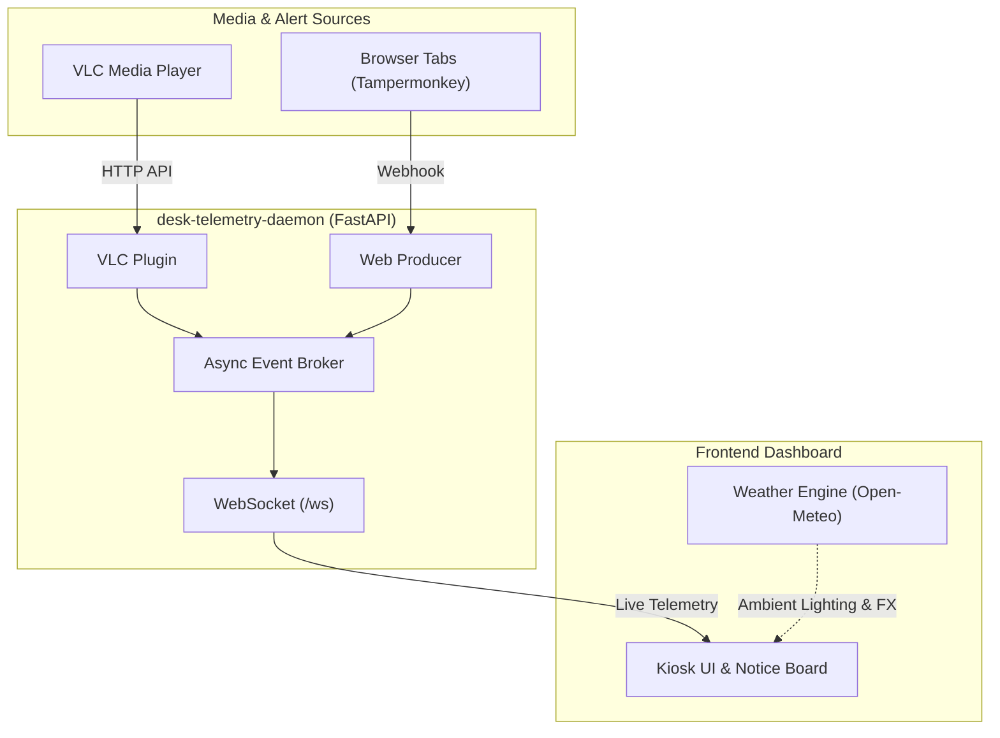

# desk-telemetry-daemon

A lightweight Windows background daemon and ambient kiosk dashboard that streams live media playback, notifications, and real-world weather effects from your PC to a dedicated desk screen.

---

## 🏗️ Architecture Overview



- **Backend**: Built on **FastAPI**, managing a central asynchronous event broker, dynamic plugin discovery, and a high-performance WebSocket endpoint.
- **Producers**: 
  - **VLC Plugin**: Polls VLC's local web interface for active playback state and metadata.
  - **Web Producer**: Receives telemetry pushed by the Tampermonkey browser script.
- **Frontend**: A responsive, kiosk-ready HTML/CSS/JS dashboard featuring video-backed ambient themes, dynamic weather effects, and a robust overlay for media playback and notifications.

---

## ✨ Key Features

- **Real-time Telemetry WebSocket**: Instant push updates from media sources and notifications to the dashboard UI.
- **Ambient Weather & Time-of-Day Lighting**: Automatically adjusts visual contrast, lighting filters, and particle simulations (rain, snow, fog, stormy weather) based on live meteorological data or manual switchers.
- **Responsive Notice Board Overlay**: Precise coordinate synchronization and responsive padding ensuring event details stay neatly within the background board boundaries across all screen sizes.
- **Robust Text Handling**: Graceful text wrapping and flexbox stability for ultra-long titles (150+ chars) and special characters/diacritics.
- **Dev Tools & Stress Testing**: Built-in mock state switchers and dedicated stress-test views for evaluating edge cases.

---

## 🚀 Getting Started

### Prerequisites
- Python 3.10+
- Modern Web Browser (Chrome, Firefox, Brave, Safari)

### Installation & Setup (Windows Automated Workflow)

1. **Clone the repository:**
   ```bash
   git clone [https://github.com/guyshargo/desk-telemetry-daemon.git](https://github.com/guyshargo/desk-telemetry-daemon.git)
   cd desk-telemetry-daemon
   ```

2. **Run Automated Setup:**
   Run the setup script in PowerShell (this automatically creates the `venv`, installs dependencies from `requirements.txt`, and creates a `Desk Telemetry` shortcut on your Desktop):
   ```powershell
   powershell -ExecutionPolicy Bypass -File .\setup.ps1
   ```

3. **Launch Desk Telemetry:**
   Double-click the **Desk Telemetry** shortcut on your Desktop to run the daemon silently in the system tray (a green status icon appears near the clock—right-click it and choose **Exit** to stop the server).

---

## 🔌 Setting Up Telemetry Producers

### 1. Browser Media & Notifications (Tampermonkey)
**Tampermonkey** is a free browser extension that runs lightweight JavaScript "userscripts" on websites you visit. This project uses a Tampermonkey script to read active playback metadata (YouTube, YouTube Music, Spotify Web, Twitch) and unread WhatsApp Web counts directly from your browser tabs and push them to the daemon's `POST /webhook` endpoint.

1. Install the **Tampermonkey** extension in your browser.
2. Open the Tampermonkey Dashboard → **Create a new script**.
3. Paste the contents of the repository's browser telemetry userscript (`universal_browser_telemetry.js`) and save (`Ctrl + S`).
4. Hard-refresh (`Ctrl + F5`) on any already-open media tabs so the script injects into them.

### 2. Local Media Playback (VLC Media Player)
The **VLC Plugin** polls VLC's built-in local HTTP API for active track titles, artists, and playback state:

1. Open VLC and go to **Tools → Preferences** (`Ctrl + P`).
2. Under **Show settings** (bottom-left), select **All**.
3. Navigate to **Interface → Main interfaces** and check the **Web** checkbox under **Extra interface modules**.
4. Expand **Main interfaces → Lua**, set a **Lua HTTP password** (matching your VLC plugin config), and restart VLC.

---

## 📱 Dedicated Kiosk Display Setup (WallPanel)

To turn an old Android phone or tablet into an always-on smart desk display, use **WallPanel**—an open-source Android kiosk browser designed for full-screen dashboards, wake-lock screen control, and remote URL display.

1. **Find your PC's local IP address:**
   Run `ipconfig` in PowerShell or Command Prompt and note your **IPv4 Address** (e.g., `192.168.1.142`).
2. **Allow Port `8000` in Windows Firewall:**
   Ensure incoming TCP traffic on port `8000` is allowed on your local network so external devices on your Wi-Fi can reach the FastAPI server.
3. **Configure WallPanel on your phone/tablet:**
   * Connect the device to the **same Wi-Fi network** as your PC.
   * Open WallPanel **Settings** (swipe inward from the left edge) → **Dashboard** → set **Dashboard URL** to `http://<YOUR-PC-IP>:8000`.
   * Go to **Display Settings** → set **Screen Orientation** to **Landscape** (the ambient scenes and notice board are designed for widescreen displays).
   * *(Tip)* After updating frontend CSS/JS files, tap **Clear Cache** in WallPanel Settings so Android's WebView loads the latest assets.

---

## 🌦️ Weather & Location Engine

The dashboard automatically syncs ambient day/night themes and particle effects (rain, snow, fog, thunderstorms) with real-world local conditions:

- **Weather Data (`Open-Meteo`):** Uses the free, open-source [Open-Meteo Forecast API](https://open-meteo.com/) (`api.open-meteo.com/v1/forecast`), which requires **no API key or account**. The frontend polls every 15 minutes for WMO weather codes.
- **Location Resolution (`Browser GPS` + `GeoJS` IP Fallback):**
  - When viewed on `localhost`, the browser requests coordinates via the standard HTML5 Geolocation API.
  - Because mobile browsers and Android WebView block HTML5 Geolocation on non-HTTPS local network IPs (`http://192.168.x.x:8000`), the weather module automatically falls back to IP-based geolocation via [GeoJS](https://www.geojs.io/) (`get.geojs.io`) so dedicated kiosk screens still receive accurate local weather and day/night transitions without manual coordinate setup.

---

## 🛠️ Development & Testing

- **Stress Scenarios**: Access `http://localhost:8000/media-state-stress.html` to test edge cases (long titles, missing artists, special characters, squeezed flex containers).
- **Mock Controls**: Open `http://localhost:8000/?dev=1` or press `H` to toggle the floating weather and view-state switcher bars during local development.
